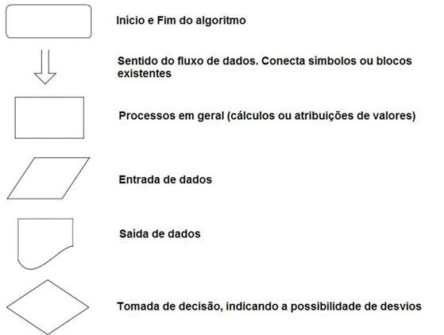
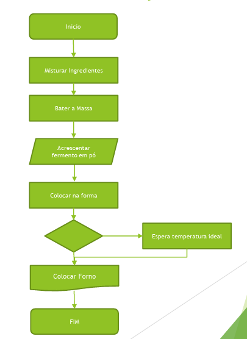
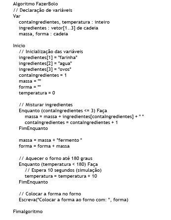
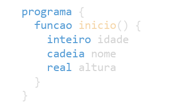
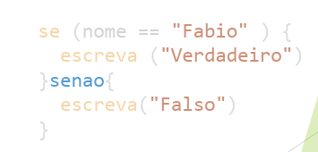
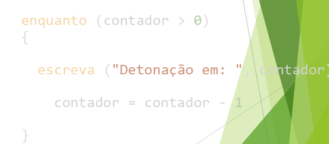
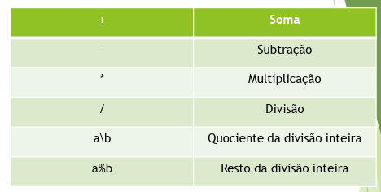
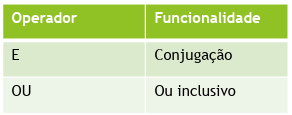

Fábio Joel Neves Alves

Indice

# O que é um algoritmo

- conjunto de regras e procedimentos lógicos perfeitamente definidos que levam à solução de um problema em um número finito de etapas.

# O que é um programa

- Sequência lógica de instruções que devem ser executadas por um computador

> LLM: é um tipo de modelo de inteligência artificial desenvolvido para processar e gerar linguagem humana.”
> 

# Métodos de representação de algoritmos

## Narrativo/descritivo

- Analisar o enunciado;
- Escrever em linguagem natural os passos a serem seguidos para a resolução do problema;
    - é como se fosse uma receita de culinária, mas para um computador fazer de forma correta teria que ser extremamente detalhada com pegar a colher pelo cabo deixando a colher virada para cima… etc..
- **vantagem:** não tem a necessidade aprender novos conceitos, pois apenas a linguagem já é o suficiente para suprir, a leitura e a ação.
- **desvantagem:** tem espaço para varias interpretações, ex: uma colher de farinha, pode ser cheia, pequena, media, raza, funda etc.

## Fluxograma

- Analisar o enunciado do problema;
- Escrever os passos a serem seguidos para a resolução do problema utilizando símbolos gráficos predefinidos;
- **vantagens:  Fácil entendimento devido aos elementos gráficos;**

- desvantagens:  É necessário aprender a simbologia dos fluxogramas;
    - O fluxo não apresenta muitos detalhes do algoritmo.
    
 
    

## Pseudocódigo

- Analisar o enunciado do problema;
- Escrever os passos a serem seguidos para a resolução do problema utilizando regras de sintaxe pré-definidas
- vantagem: A transição do algoritmo para qualquer linguagem de programação é quase imediata, basta conhecer as palavras reservadas;
- desvantagens: É necessário aprender as regras do pseudocódigo e sintaxe.

# Construção de um algoritmo

- compreender
    - ver quais são os problemas a serem resolvidos
- identificar dados
    - quais são os dados de entrada, que o usuário vai fornecer;
    - quais são os dados esperados de respostas que o usuário necessita (dados de saída);
- Determinar os procedimentos a executar com os dados de entrada para obter os dados de saída
    - como trabalhar os dados até a saída;
- Construir o algoritmo
    - construção com possível solução;
- Testar
    - assegurar que não há erros;
- Implementar
    - colocar em produção;

# Boas praticas

- clareza e simplicidade
    - português ou inglês simples
    - sem abreviações, ou estruturas complexas
    - cada instrução deve ser clara e fácil, com nomes objetivos
- estruturas
    - inicio e fim bem explícitos
    - usar a indentação corretas para mostrar blocos de códigos
    - sequencia lógica: entrada → processamento → saída
- declaração de variáveis
    - declarar as variáveis no início ou antes do uso
    - usar nomes que tem sentido, idade, total, soma, media, e que facilite a leitura
- uso correto de estruturas de controle
    - condições bem definidas (se… então… senão)
    - (para, enquanto, repita…até) usados quando necessários
    - evitar lógica redundante e desnecessária
- entrada e saída de dados
    - saber com clareza o que recebe e o que sai
    - deixar claro quais informações o utilizador deve introduzir
- testabilidade
    - O algoritmo deve ser fácil de testar com exemplos simples.
    - Inclui comentários ou instruções que ajudem a validar o funcionamento.
- modularidade (se aplicável)
    - dividir as funções → cada função tem uma responsabilidade clara
- tratamento de erros (opcional)
    - validação de entrada (números, letras, vazio, etc..)
    - Usar estruturas como Se entrada inválida Então... para maior robustez.

# Elementos básicos para construção do algoritmo

- Constantes → Valores fixos. Não deve ser alterado ao longo do programa
- Variáveis → Elemento cujo o seu valor pode ser modificado ao longo da execução;
    - Uma variável representa uma posição de memória a partir do qual podem ser armazenados dados.
- regras chaves
    - O nome das variáveis de ser representativo, dos dados que vão armazenar (int = numeros etc);
    - O primeiro carácter deve ser alfabético, preferencialmente minúsculo (camelCase);
    - Os nomes não devem ter espaços;
    - Nomes utilizados na referencia de variáveis e/ou constantes não podem:
        - Coincidir com nomes de palavras reservadas (definidas pela linguagem algorítmico e/ou de funções criadas pelo utilizador)
        - Começar com dígitos nem conter, sublinhado, negrito e/ou itálico
- declaração de variáveis
    - tipo nomeVariavel
    - Exemplo
        - inteiro idade
        - cadeia nome

## Palavras reservadas

- são comandos, operadores ou estruturas já definidas pela linguagem usada
- indicam ações, tipos de dados, tipos de dados, estruturas de controle.
- o programador não pode usar elas para outros fins

## Tipos de dados

- real- Permite guardar números como 3.14, 2.718, -0.5, 100.0, etc.
    - Em algumas linguagens, pode ser chamado de float ou double.
- inteiro - Armazena valores como: -10, 0, 25, 1000,…
    - Não aceita valores com vírgula ou ponto decimal (ex: 3.14 não é válido como inteiro).
- cadeia - Armazena letras, palavras ou frases.
    - É equivalente ao tipo string em outras linguagens como Python, Java, C, etc.
      

## Estruturas condicionais

se ... senao 
escolha … caso …senão

## Ciclos

enquanto 

faca … enquanto

## Funções

 leia() → função → Lê dados do utilizador (entrada) 

escreva() → função → Mostra dados no ecrã (saída)

retorne → palavra-chave → Devolve um valor de uma função

inicio → palavra-chave → Marca o início do programa principal

função → palavra-chave → Declara uma função

# Operadores

## Operadores matemáticos

## Operadores relacionais

!

## Operadores lógicos

## Fluxograma

